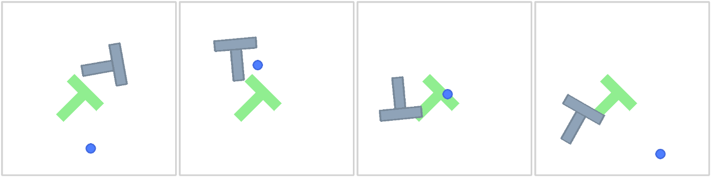
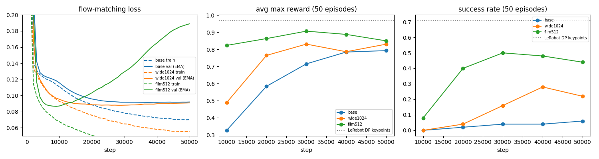
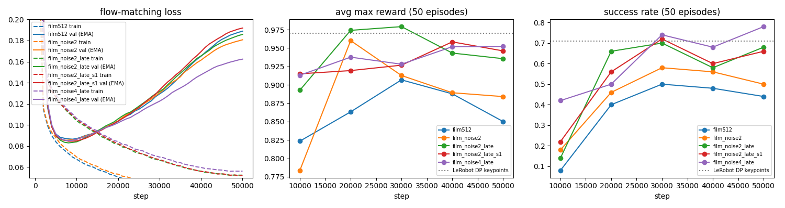
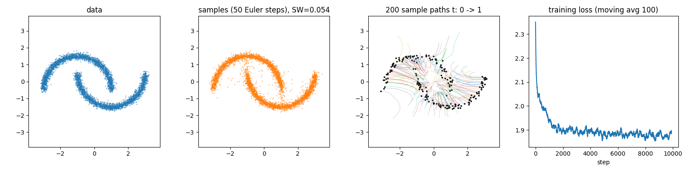

# Flow-matching robot policy from scratch

A π0-style flow-matching action policy, written from scratch in NumPy (own MLP, backprop, Adam, sampler).
A C++ port (std, maybe Eigen, no ML libraries) comes in M3. Evaluated on PushT (`gym-pusht` +
`lerobot/pusht_keypoints`) against LeRobot's diffusion policy, then deployed on a real arm.
PyTorch is used only for gradient checks.



*Best M2 policy (FiLM + obs noise + late-t sampling): 70.0 % success on 500 test episodes, one training seed.
These 4 episodes (test seeds 200000-200003) all succeed; 30 % of episodes do not.*

## Milestones
| | Milestone | Status |
|---|---|---|
| M0 | Setup: repo, env, inspect PushT env and dataset | done |
| M1 | 2D flow-matching toy in NumPy (own MLP, backprop, Adam) | done |
| M2 | Flow-matching policy on PushT keypoints (NumPy), compared with LeRobot's diffusion policy | 70.0 % success (LeRobot DP: 71.0 %); seed repeats pending |
| M3 | C++ port (std, maybe Eigen, no ML libraries) | |
| M4 | Vision: policy from images | |
| M5 | Real robot arm | |
| M6 | Ship: write-up, demo, release | |

## Results
PushT, keypoints + agent position. Success = max coverage > 95 % within 300 steps.

| Policy | Success rate | Avg max reward | Episodes | Notes |
|---|---|---|---|---|
| Flow matching, FiLM residual MLP + obs noise 4 px + late-t sampling (NumPy, ours) | **70.0 % ± 2.0** (95 % CI 66.0–74.0) | 0.946 | 500 (test seeds) | 2.4 M params, CPU, ~50 min training, 1 training seed |
| Flow matching (C++, ours) | – | – | | M3 |
| LeRobot diffusion policy (keypoints) | 71.0 % | 0.97 | 500 | from the [model card](https://huggingface.co/lerobot/diffusion_pusht_keypoints), not re-measured |

± = one standard error over 500 episodes, sqrt(p(1-p)/500); 95 % CI = ± 1.96 s.e. LeRobot's card gives no eval seeds or checkpoint step, and says 50 episodes in its usage
text but 500 in its results table. More baselines (including the original paper) in `docs/BASELINES.md`.

## M2: flow-matching policy on PushT
**Setup**
- Observation: 2 frames × (16 T-keypoint coordinates + agent x, y) = 36-D, normalised to [-1, 1] with min/max from
  the training episodes only (185 train / 21 val episodes).
- Action: chunk of 16 target positions (16 × 2). Execute the first 8, then replan.
- Flow: linear path from noise (t=0) to the action chunk (t=1), loss = MSE on the velocity, 10 Euler steps to sample.
- Training: Adam, lr 1e-3 with warm-up and cosine decay, batch 256, 50k steps, EMA 0.999 of the weights.
- Checkpoints are chosen on eval seeds 100000–100049; reported numbers use separate test seeds 200000–200499.

**What made the difference: conditioning, not size** (500 test episodes each, ± = 1 s.e.)

| Network | Params | Success | Avg max reward | Best-of-8 action error, train / val |
|---|---|---|---|---|
| Concat MLP 512×3 | 0.59 M | 8.2 % ± 1.2 | 0.744 | 11.6 / 15.0 px |
| Concat MLP 1024×3 | 2.2 M | 21.0 % ± 1.8 | 0.844 | 9.7 / 14.5 px |
| **FiLM residual MLP 512×3** | 2.4 M | **49.6 % ± 2.2** | **0.897** | 6.0 / 16.6 px |

- Concat MLP: the observation and time embedding are just concatenated to the noisy actions at the input.
- FiLM: the observation and time go through a small encoder that gives a scale and shift to every residual block,
  as in Diffusion Policy's U-Net. At the same size it more than doubles the success rate.
- Ruled out first: more Euler steps (30) or replanning more often (execute 4) did not help, so the problem was the
  model, not sampling.
- Best-of-8 error: about half of the one-sample error comes from the model picking a different (valid) pushing mode.
- FiLM overfits: its val loss rises from 0.087 (9k steps) to 0.19 (50k) while train loss keeps falling.



**From 49.6 % to 70.0 %: regularisation and where the flow trains** (FiLM 512×3, 500 test episodes, ± 2.0-2.2 s.e.)

| Change (one at a time) | Success, best ckpt | Success, 50k ckpt | Avg max reward (best) |
|---|---|---|---|
| FiLM | 49.6 % | 47.4 % | 0.897 |
| + weight decay 0.05 | 40.6 % | 49.0 % | 0.925 |
| + obs noise 2 px | 58.4 % | 58.0 % | 0.900 |
| + obs noise 4 px | 60.0 % | 64.6 % | 0.912 |
| + obs noise 2 px + late t | 65.4 % | 63.0 % | 0.951 |
| same, training seed 1 | 61.6 % | 62.6 % | 0.952 |
| **+ obs noise 4 px + late t** | **70.0 %** | **70.0 %** | 0.946 |

- Obs noise: Gaussian noise (in pixels) on the 36 observation values during training. +10 points.
- Late t: train the flow more near t=1, the data end, where fine alignment is decided (t = sqrt(u), density 2t).
  +5-7 points, and the highest coverage.
- Weight decay: no effect.
- Seed-to-seed spread (two training seeds of the same setup): about 2-4 points. The 70.0 % run has one seed so far.
- Val loss rises in every run, even when closed-loop success improves: on this task it is a poor checkpoint selector.
- Failures of the 70 % policy: 116 of 150 are near misses (max coverage 0.90-0.95), 27 never pass 0.5.



## PushT env notes (checked in `python/scripts/m2_inspect.py`)
- `obs_type="environment_state_agent_pos"` matches `lerobot/pusht_keypoints` exactly: same 16 keypoint order,
  pixel units in [0, 512]; max error 2.7e-5 px over all 25,650 frames (swapping the T's two rectangles gives 81 px),
  and open-loop replay of recorded actions reproduces whole episodes.
- Gotcha 1: `reset_to_state` sets the block position *before* the angle, and pymunk rotates about the centre of
  gravity (0, 45), so the block origin moves by `cog - R(theta) cog`. Pre-compensate to reset to a dataset frame.
- Gotcha 2: the dataset's `next.reward` is not the env's reward and `next.success` is never True, although replays
  reach env success. Score success and coverage only from the env's `info`.

## Layout
```
python/flowmatch/   NumPy code: mlp.py, film.py, adam.py, flow.py (M1), policy.py, data.py, eval_pusht.py
python/scripts/     m0_inspect, m1_toy2d, m2_inspect, m2_data_check, m2_train, m2_eval, m2_offline_eval, m2_plot_runs
python/tests/       gradient checks vs torch and finite differences, data pipeline tests
cpp/                C++ port (M3)
notebooks/          Colab/Kaggle notebooks
docs/PROGRESS.md    one line per session; docs/BASELINES.md: published numbers with sources
```

## Setup and commands
```bash
python3 -m venv .venv && source .venv/bin/activate
pip install -r requirements.txt -r requirements-dev.txt   # dev = torch (grad checks only) + pytest
export PYTHONPATH=python                                   # replaces any ROS PYTHONPATH
pytest -q

python python/scripts/m1_toy2d.py --data moons                                   # M1 toy
python python/scripts/m2_train.py --run film_noise4_late --arch film --steps 50000 \
    --obs-noise 4 --t-sampling late                                                # best M2 config (CPU, ~50 min)
python python/scripts/m2_eval.py --ckpt checkpoints/film_noise4_late/best.npz --episodes 500   # test seeds
python python/scripts/m2_offline_eval.py --ckpt checkpoints/film_noise4_late/best.npz
```

## M1: 2D flow-matching toy (10k steps, batch 512, MLP 3x128 SiLU, 50 Euler steps)
Sliced Wasserstein distance to data (lower is better; floor = data vs fresh data).

| Dataset | SW samples | floor | noise | train time (CPU) |
|---|---|---|---|---|
| moons | 0.054 | 0.046 | 0.421 | 21 s |
| checkerboard | 0.027 | 0.021 | 0.207 | 42 s |
| 8 gaussians | 0.024 | 0.017 | 0.505 | 23 s |

Checkerboard at 30k steps: SW 0.028, squares visibly sharper; SW misses this.

Convention: t=0 is noise, t=1 is data (π0 uses the opposite).


